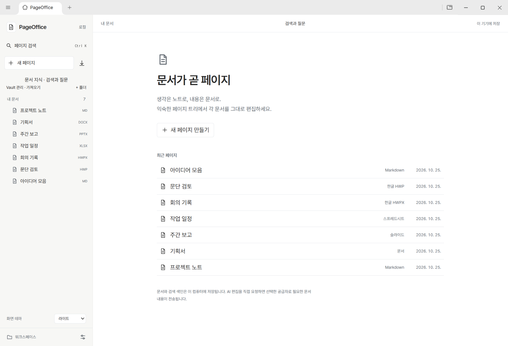
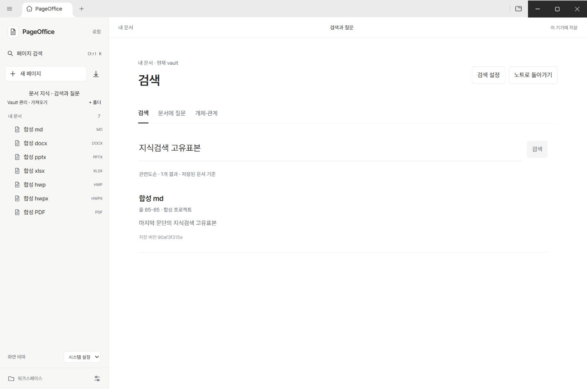
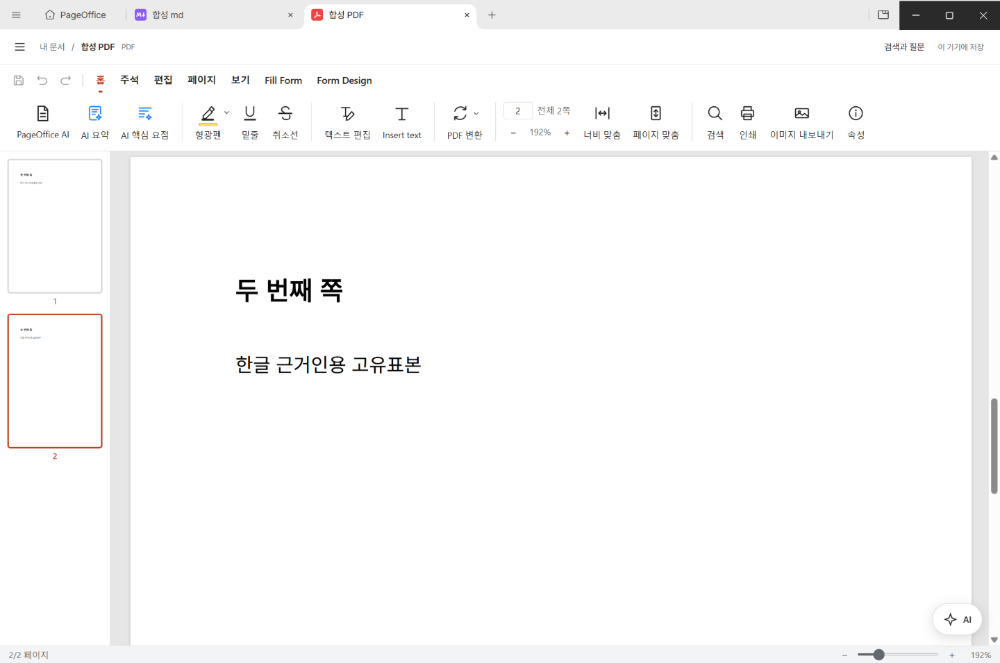

# PageOffice

> 소스 업로드 진행 중입니다. 현재는 소개·화면·출처 안내를 먼저 공개했으며, 전체 소스 트리와 파일 검증은 아직 완료되지 않았습니다.

### 기록은 노트처럼, 연결은 지식처럼, 작업은 오피스로.

**노트의 정리 방식, 위키 링크, 원본 Office 문서를 하나의 vault에서 관리하는 올인원 작업 공간.**

생각은 Markdown으로 남기고, 기획서는 DOCX로, 발표는 PPTX로, 일정과 수치는 XLSX로 작업하세요. HWP·HWPX와 PDF도 같은 페이지 트리에서 열 수 있습니다. 문서를 노트에 첨부하는 대신 **각 파일 자체가 하나의 페이지**입니다.

Notion에 익숙한 정리 방식과 Obsidian 스타일의 연결을 참고하되 제휴나 완전 호환을 의미하지 않습니다. Office 파일을 Markdown으로 변환하지 않고 기존 편집 엔진을 사용합니다.

*실제 0.4.0 화면. 개인 자료 대신 합성 문서를 사용했습니다.*

## 한곳에서 정리하고, 원본으로 작업하세요

- **이동 가능한 vault** — 폴더 단위로 만들고 열고 전환합니다. 페이지 ID·계층·순서를 유지하며 이름 변경과 이동 후에도 연결을 이어갑니다.
- **블록과 링크** — Markdown 블록 조작, `[[문서|표시명]]`, 제목/블록 참조, 백링크와 로컬 임베드를 제공합니다.
- **7종 문서 페이지** — MD·DOCX·PPTX·XLSX·HWP·HWPX·PDF를 해당 편집기로 엽니다.
- **내용으로 찾기** — 현재 vault의 제목·별칭·태그·본문을 로컬에서 검색하고 저장 버전과 원문 위치를 확인합니다.
- **가벼운 주변 UI** — 기본 오버레이 drawer와 선택적 고정 사이드바, 작은 AI 아이콘과 플로팅 창, 라이트·다크·시스템 테마와 시스템 UI 글꼴을 지원합니다.

## 정리한 자료를 지식으로 이어가기

### 중앙 화면에서 바로 검색

검색 결과는 별도 모달이 아닌 콘텐츠 영역에 표시됩니다. 원문을 열고 돌아오면 검색어·선택·스크롤 위치를 유지합니다. Kordoc 추출과 FTS/BM25·한글 문자 토큰을 사용하며, 캐시는 vault와 분리된 기기별 데이터로 둡니다. 고급 옵션과 재색인은 통합 설정의 검색 탭에서 다룹니다.

*저장된 합성 Markdown 본문을 검색한 실제 결과입니다.*

### 답변보다 먼저, 확인할 수 있는 근거

문서 질문은 검색 근거와 출처·버전을 먼저 보여줍니다. 공급자와 전송 범위를 확인하고 명시적으로 요청하는 구조입니다. **실제 AI 편집·답변에는 사용자가 설정한 공급자와 키가 필요합니다.** 현재 검증판에서는 키 연결과 실제 모델 호출·답변 품질을 검증하지 않았습니다. 오프라인 테스트 응답을 실제 AI 성공으로 표시하지 않습니다.

개체·관계 기능은 문서에 명시된 항목과 링크를 바탕으로 후보를 만들고 사용자 승인·수정·제외를 기록합니다. 동명이인을 자동 병합하지 않으며, 원문 변경·삭제 시 근거를 무효화합니다. AI 자동 추출은 대기 범위입니다.

*검색 근거에서 실제 두 번째 쪽으로 이동한 합성 PDF. 한글 렌더링과 쪽 위치를 확인했습니다.*

## 지원 형식과 현재 범위

| 형식 | 지원 범위 |
| --- | --- |
| MD | 블록 조작, 링크·백링크·로컬 임베드, 저장·본문 검색 |
| DOCX | 기존 문서 엔진 편집·저장, 제목/블록 근거. 가짜 쪽 번호를 붙이지 않습니다. |
| PPTX | 기존 슬라이드 엔진, 슬라이드 단위 검색 근거와 이동 |
| XLSX | 기존 스프레드시트 엔진, 시트 단위 검색 근거와 이동 |
| HWP / HWPX | 로컬 rhwp 편집, 제한된 문단 수정안 검토·적용·undo. 조판/구역 근사를 구분하며 무손실을 가정하지 않습니다. |
| PDF | 기존 뷰어·주석/페이지 작업 범위, 텍스트 추출과 실제 쪽 인용. Word 같은 전체 본문 편집을 의미하지 않습니다. |

OCR·수식 OCR·모델 다운로드는 꺼져 있습니다. 암호·배포용·DRM 문서는 색인에서 건너뛰고 스캔·차트·숨김 슬라이드 등 누락 가능성을 표시합니다. 크기·시간·메모리 및 PDF 200쪽 제한이 있습니다. DOCX/HWP의 정확한 본문 위치 점프까지 보장하지 않습니다.

## 기존 노트 가져오기

Obsidian vault와 Notion Markdown/CSV 내보내기를 **원본 보존형 복사본 가져오기**로 다룹니다. 미리보기 후 확정하며 원본·첨부·해시·미해결 링크·미지원 내용을 보고합니다. 외부 임베드를 자동 요청하거나 가져온 스크립트·플러그인을 실행하지 않습니다.

Notion 데이터베이스 관계·수식·롤업·뷰의 완전 복원과 협업·댓글·버전 이력 이주는 지원하지 않습니다. 실제 자료는 먼저 복사본으로 시험하세요.

## 시작하기

현재 저장소는 **0.4.0 소스 스냅샷**입니다. GitHub Release에 설치 EXE를 게시하지 않았으므로 존재하지 않는 다운로드 링크를 제공하지 않습니다. 별도로 확인한 Windows 설치본은 미서명 시험판입니다.

소스 빌드는 [빌드 안내](docs/BUILD-PAGEOFFICE.md)를 참고하세요. 선별한 공개 트리의 클린 빌드는 아직 미검증입니다. 이전 설치본의 관련 단위 178개와 설치 앱 106항목 통과가 새 빌드의 호환성·안전성을 보증하지는 않습니다.

## 오픈소스 기반과 출처

| 구성요소 | PageOffice 활용 범위 | 확인한 고지 |
| --- | --- | --- |
| [GenOffice](https://github.com/genspark-ai/genoffice) | Electron 셸, 기존 편집 엔진과 AI 공급자 인터페이스를 확장 | Apache-2.0. 별도 ee 상용 코드는 제외 |
| [rhwp](https://github.com/edwardkim/rhwp) 0.8.7 | HWP/HWPX 로컬 Studio/WASM, 저장과 제한된 명령 | MIT. 폰트·포함 자산 고지는 별도 유지 |
| [Kordoc](https://github.com/chrisryugj/kordoc) 4.24.4 | 바이트 기반 제한 워커의 오프라인 추출 | MIT 및 배포 NOTICE. 선택적 AGPL OCR 모델 가중치 미포함·미사용 |
| Univer / Tiptap / ProseMirror / PptxGenJS / EmbedPDF / Electron | 기존 편집기와 런타임의 구성요소 | 정확한 패키지별 버전과 원문 조건은 상세 문서에 구분 |

브랜딩 변경은 법적 출처 고지 삭제와 다릅니다. 원본 LICENSE·NOTICE·저작권·수정 이력을 보존합니다. [출처·활용 범위·수정 내역](docs/OPEN_SOURCE.md), [고지 전문](apps/shell/build/THIRD-PARTY-NOTICES.txt), [원본 고지 모음](vendor/licenses)을 확인하세요.

**남은 검토:** `ot-text-unicode 4.0.0`의 ISC/MIT 고지 충돌, 독립 법무·보안·네이티브 공급망 감사, 코드 서명, 실 AI 및 복잡한 MS Office/한컴 문서 대조 검증이 남아 있습니다. 상용 배포 적합성이나 무손실 호환성을 보증하지 않습니다.

## 앞으로

- 실제 문서·공급자 연결의 호환성 검증 확대
- 검색 근거·링크·관계 검토 경험 보완
- 서명된 설치본과 재현 가능한 배포 절차 검토
- vault 버전·충돌 정책을 바탕으로 Google Drive 동기화 검토

Google Drive 연결·업로드·동기화는 아직 구현하지 않았습니다. 로드맵과 현재 기능을 구분합니다.

## 기능 제안과 기여

지원이 필요한 작업 흐름과 불편한 점을 알려주세요.

**기능 제안: [hso1025@gmail.com](mailto:hso1025@gmail.com)**

재현에는 개인정보를 제거한 합성 표본을 사용하고 API 키·개인 문서·vault를 공개 이슈나 PR에 올리지 마세요. 오픈소스 고지와 사용자 원본 보존 원칙을 유지하는 기여를 환영합니다.
